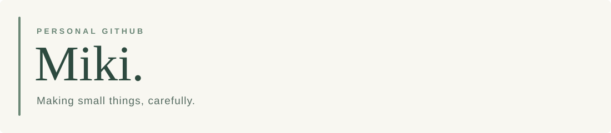

<!-- Miki / GitHub Profile · English -->

  <picture>
    <source media="(prefers-color-scheme: dark)" srcset="./assets/header-dark.svg">
    
  </picture>

  

    <a href="https://omiki0826o.github.io/">Website</a>
    &nbsp;·&nbsp;
    <a href="https://github.com/oMiki0826o?tab=repositories">Repositories</a>
    &nbsp;·&nbsp;
    <a href="https://omiki0826o.github.io/zh-TW/notes/">Notes</a>
    &nbsp;·&nbsp;
    <a href="./README.md">繁體中文</a>
  

## About

Hi, I'm **Miki** — a student who enjoys coding, astronomy, and the technical side of Minecraft.

My projects usually begin with a practical problem or a spontaneous idea: a Discord bot, an astronomy tool, a markup language, or a small website. I care less about the number of features than whether something is **useful, understandable, and maintainable**.

I mainly work with Python, TypeScript, and web technologies, while exploring Minecraft modding, astrophotography, and AI integrations.

## Selected projects

| Project | Description |
| :--- | :--- |
| **[Discord Bot](https://github.com/oMiki0826o/Discord-bot)** | A modular Discord bot for community tools, music, AI integration, and Minecraft server communication and management. |
| **[StructMark](https://github.com/oMiki0826o/StructMark)** | A lightweight markup language with a lexer, parser, AST, and safe HTML output. |
| **[AstroLab](https://github.com/oMiki0826o/AstroLab)** | Browser-based astronomy tools for finding objects and planning observations and imaging sessions. |
| **[NoteBlock Tweaks](https://github.com/oMiki0826o/NoteBlockTweaks)** | A client-side Minecraft Fabric mod for easier note-block tuning. |
| **[Small Things Lab](https://github.com/oMiki0826o/STLab)** | Practical, login-free web tools for schedules and data visualization. |
| **[CipherTool Web](https://github.com/oMiki0826o/CipherTool-Web)** | A browser workbench for learning classical ciphers, encodings, and text transformations. |

Other explorations include [AI Development Governance](https://github.com/oMiki0826o/AI-Development-Governance) and the Python-based [CipherTool](https://github.com/oMiki0826o/CipherTool). Browse [all repositories](https://github.com/oMiki0826o?tab=repositories) for more.

## GitHub activity

  <picture>
    <source media="(prefers-color-scheme: dark)" srcset="https://github-readme-stats.vercel.app/api?username=oMiki0826o&amp;show_icons=true&amp;hide_rank=false&amp;rank_icon=default&amp;hide_border=true&amp;bg_color=00000000&amp;title_color=dce6dc&amp;text_color=b9cabd&amp;icon_color=92b399" />
    
  </picture>
   
  <picture>
    <source media="(prefers-color-scheme: dark)" srcset="https://github-readme-stats.vercel.app/api/top-langs/?username=oMiki0826o&amp;layout=compact&amp;langs_count=6&amp;hide_border=true&amp;bg_color=00000000&amp;title_color=dce6dc&amp;text_color=b9cabd" />
    
  </picture>

The rank is a third-party statistic, not an official GitHub score. Language percentages reflect repository contents, not proficiency.

## Technologies

| Area | Tools |
| :--- | :--- |
| Languages | Python, TypeScript, JavaScript, Java, HTML, CSS |
| Web | Next.js, React, Node.js, static sites, GitHub Pages |
| Bots & gaming | discord.py, Minecraft Fabric |
| Data & tooling | SQLite, Git, GitHub Actions, VS Code, FFmpeg |

## Interests

Astronomy and astrophotography, Minecraft redstone and modding, and building small tools that solve real problems. A project doesn't have to be huge to be worth making — getting the details right is part of the fun.

## Contribution graph

  <picture>
    <source media="(prefers-color-scheme: dark)" srcset="https://raw.githubusercontent.com/oMiki0826o/oMiki0826o/output/snake-dark.svg" />
    
  </picture>

---

  Made with curiosity, built with care.
   
  <a href="https://github.com/oMiki0826o">github.com/oMiki0826o</a>

