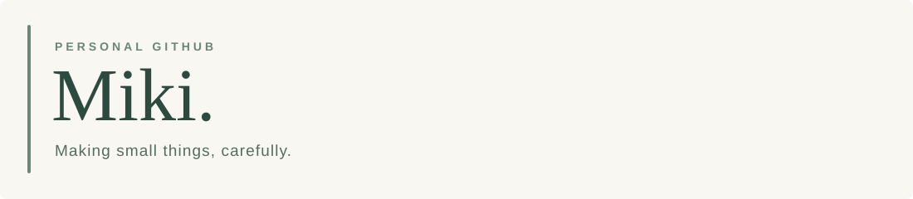
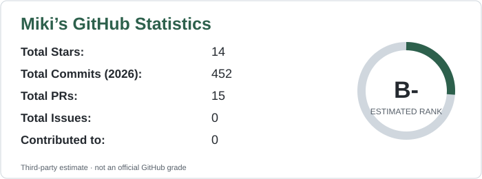
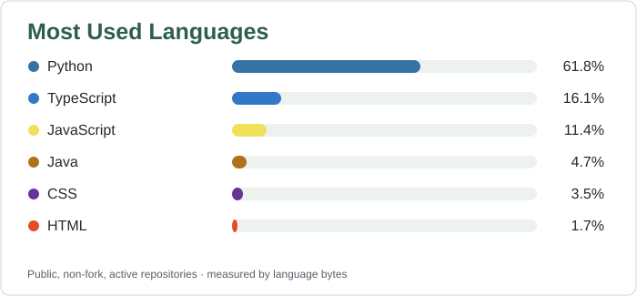

  <picture>
    <source media="(prefers-color-scheme: dark)" srcset="./assets/header-dark.svg">
    
  </picture>

  <a href="https://omiki0826o.github.io/">個人網站</a> · <a href="https://github.com/oMiki0826o?tab=repositories">所有專案</a> · <a href="https://omiki0826o.github.io/zh-TW/notes/">筆記</a>

### 你好，這裡是 Miki。

余處幽篁兮終不見天，路險難兮獨後來。

## 精選作品

<!-- PINNED_PROJECTS_START -->
| 專案 | 簡介 |
| :--- | :--- |
| [查看 GitHub 釘選作品](https://github.com/oMiki0826o) | 自動同步釘選專案中 |
<!-- PINNED_PROJECTS_END -->

## GitHub 活動

  <picture>
    <source media="(prefers-color-scheme: dark)" srcset="./assets/stats-dark.svg">
    
  </picture>
   
  <picture>
    <source media="(prefers-color-scheme: dark)" srcset="./assets/top-langs-dark.svg">
    
  </picture>

## 技術與工具

| 領域 | 技術 |
| :--- | :--- |
| Languages | Python · TypeScript · JavaScript · Java · C |
| Frontend | Next.js · React · HTML · CSS |
| Backend | Node.js · Python · SQLite |
| Tools | Git · GitHub Actions · VS Code · FFmpeg |
| Minecraft | Fabric |

## 貢獻紀錄

  <picture>
    <source media="(prefers-color-scheme: dark)" srcset="https://raw.githubusercontent.com/oMiki0826o/oMiki0826o/output/snake-dark.svg">
    
  </picture>

